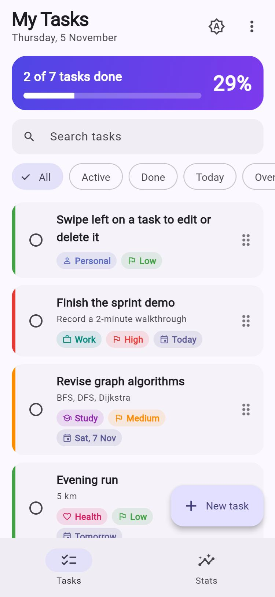
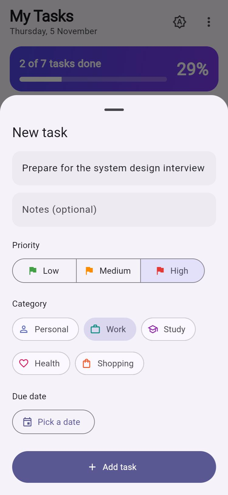
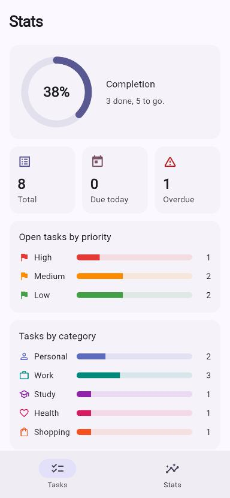
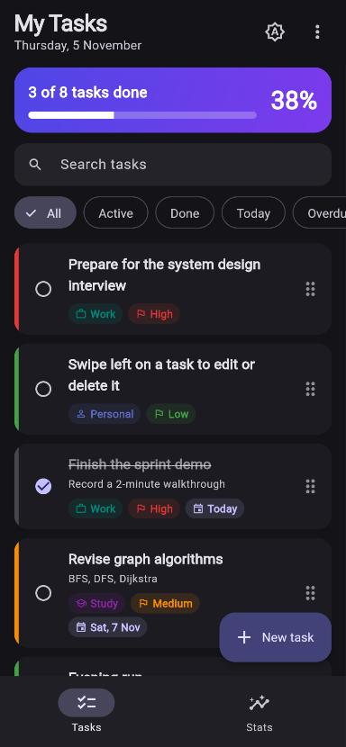
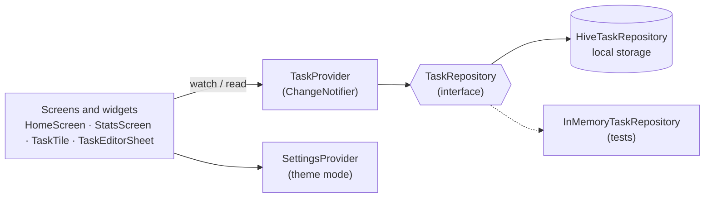

<div align="center">

# ✅ Taskly

**A clean, offline-first to-do app built with Flutter and Material 3.**
Priorities, due dates, categories, search and filters, drag-to-reorder, undo, a stats dashboard, and light / dark themes. Your tasks are saved on the device.

[](https://github.com/codedchaitanya/Flutter_Project/actions/workflows/flutter.yml)


### [▶ Try the live web demo](https://codedchaitanya.github.io/Flutter_Project/) · [⬇ Download the Android APK](https://github.com/codedchaitanya/Flutter_Project/releases/latest)

&nbsp;
&nbsp;
&nbsp;


</div>

---

## ✨ Features

| | |
|---|---|
| 📝 **Tasks** | Add, edit and delete tasks with a title and optional notes, in a Material 3 bottom sheet with validation. |
| 🚩 **Priority** | Low / Medium / High, shown as a coloured strip and a tag on each card. |
| 🗂️ **Categories** | Personal, Work, Study, Health, Shopping, each with its own icon and colour. |
| 📅 **Due dates** | Date picker; cards show *Today*, *Tomorrow* or the date, and overdue tasks are flagged in red. |
| 🔎 **Search and filters** | Live search over titles and notes; filter by All / Active / Done / Today / Overdue and by category. |
| ↕️ **Drag to reorder** | Reorder with the drag handle; the order is saved. |
| 👉 **Swipe actions** | Swipe left to edit or delete (`flutter_slidable`). |
| ↩️ **Undo** | Deleting shows a snackbar with **UNDO**, which restores the task in its old place. |
| 📊 **Stats dashboard** | Animated completion ring, totals, due today, overdue, and bar charts by priority and category (custom painter, no chart library). |
| 🌗 **Themes** | Light, dark or follow the system, remembered between launches. |
| 💾 **Offline storage** | Everything is stored locally with **Hive** (IndexedDB on the web), so it works without a network. |

## 🏗️ Architecture

The UI only talks to **providers**; providers only talk to a **repository** interface. That keeps the widgets simple and lets the tests swap Hive for an in-memory store.



```
lib/
├── main.dart                  # Hive setup, first-run sample tasks, runApp
├── app.dart                   # MultiProvider + MaterialApp (light / dark themes)
├── models/task.dart           # immutable Task, Priority and TaskCategory enums, toMap / fromMap
├── data/
│   ├── task_repository.dart   # TaskRepository interface, Hive and in-memory versions
│   └── sample_tasks.dart      # example tasks for the first launch
├── state/
│   ├── task_provider.dart     # CRUD, undo, filters, search, reorder, stats
│   └── settings_provider.dart # theme mode, saved in Hive
├── screens/                   # shell (bottom navigation), home, stats
├── widgets/                   # task tile, editor sheet, empty state
└── theme/app_theme.dart       # Material 3 theme from one seed colour
```

**Design choices**

- **Provider + ChangeNotifier**: small, readable state management that fits an app this size; `context.select` keeps the progress card from rebuilding on unrelated changes.
- **Repository pattern**: storage sits behind an interface, so moving to SQLite or a cloud backend would only touch `data/`.
- **Immutable model**: `Task` is immutable with `copyWith` and value equality, so changes are explicit and easy to test.
- **Injectable clock**: `TaskProvider` takes a `clock` function, so tests can fix "today" for due-date and overdue logic.

## 🧪 Testing and CI

16 tests, run on every push by GitHub Actions:

- **Unit tests** (`test/task_model_test.dart`, `test/task_provider_test.dart`): serialisation round trip, overdue rules, add / toggle / delete / undo, combined filters and search, reorder that survives a reload, stats, clear completed.
- **Widget tests** (`test/widget_test.dart`): empty state, adding a task through the sheet (including validation), ticking a task updates the progress card, search, stats tab.

The [workflow](.github/workflows/flutter.yml) checks formatting, runs `flutter analyze` and the tests, builds the web app and deploys it to **GitHub Pages**, and builds a release **APK**, which is attached to each GitHub Release.

## 🚀 Run it locally

Requires the [Flutter SDK](https://docs.flutter.dev/get-started/install) (stable channel).

```bash
git clone https://github.com/codedchaitanya/Flutter_Project.git
cd Flutter_Project
flutter pub get
flutter run              # on a connected device or emulator
flutter run -d chrome    # in the browser
flutter test             # run the test suite
flutter build apk        # release APK in build/app/outputs/flutter-apk/
```

## 🛠️ Tech stack

| Area | Tools |
|---|---|
| Framework | Flutter, Dart 3 (records, pattern matching, switch expressions) |
| UI | Material 3, `NavigationBar`, `SegmentedButton`, `ChoiceChip`, `ReorderableListView`, `CustomPainter`, implicit animations |
| State | `provider` |
| Storage | `hive_flutter` |
| Other packages | `flutter_slidable`, `intl` |
| Quality | `flutter_test`, `flutter_lints`, GitHub Actions |

## 🗺️ Roadmap

- [ ] Reminder notifications for due tasks
- [ ] Sub-tasks and recurring tasks
- [ ] Cloud sync and sign-in (Firebase)
- [ ] Home-screen widget

## 👤 Author

**Chaitanya Roy**: [GitHub @codedchaitanya](https://github.com/codedchaitanya)
